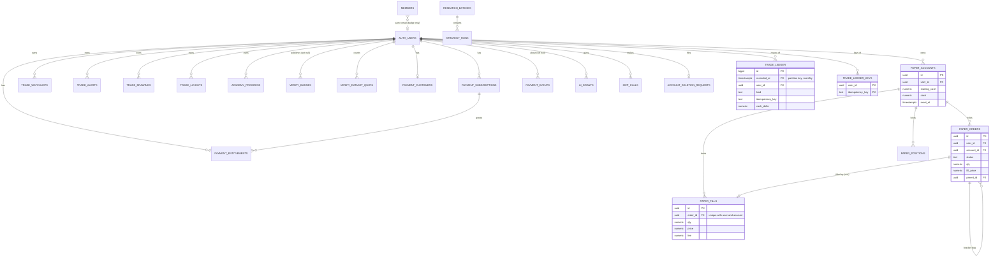

# Parity database schema and data model

## In plain words

This is the map of everything Parity keeps in its database: who owns each table, what links to what, who may read or change it, and how long it is kept. Most tables belong to one signed-in person, and that person is the only one who can see their rows. A few tables hold research results or anonymous totals that anyone may read. The rules for changing the database are at the end.

## Summary

- 34 tables in the `public` schema, plus the trade ledger's monthly partitions in `parity_private`, a schema the API does not serve. All of them have row level security on and at least one rule.
- Every table a person writes to points at `auth.users` with `on delete cascade`, except two that keep a trace on purpose: published Verify badges are withdrawn (numbers wiped), and Stripe payment events keep the event id without the person.
- Money, prices and quantities are `numeric` everywhere. Times are `timestamptz`; trading days are `date`. The only floating point columns are durations and timing totals.
- Every foreign key and every row rule has an index behind it. A test fails the build if one is missing (`supabase/tests/test_data_model.sql`).
- Demo trading has an append-only ledger with an idempotency key per event, and an order can have only one fill ([DEC-0054](../decisions/0054-the-data-model-is-strict-indexed-and-keeps-an-append-only-trade-ledger.md)).
- One function, `delete_account_data(user)`, removes everything that names a person.

## The tables by area

| Area | Tables | Owner of each row | Who reads | Who writes |
| --- | --- | --- | --- | --- |
| Accounts | `auth.users` (Supabase), `members`, `account_deletion_requests`, `account_deletion_log` | the person | own row | Supabase Auth; the person files a request; the owner or service role deletes |
| Research | `research_batches`, `strategy_runs`, `search_snapshots`, `sim_snapshots`, `profile_snapshots`, `service_heartbeats` | Parity | signed-in people (batches, runs); anyone (heartbeats); nobody (snapshots) | the writer login and the services |
| Latency ([DEC-0045](../decisions/0045-we-track-how-old-our-data-is-at-every-hop-and-how-fast-pages-get-it.md)) | `data_freshness`, `pipeline_steps`, `rum_hourly`, `rum_minute`, `rum_hour_rows` | Parity | anyone (the first three) | checked functions only |
| Trade tools | `trade_watchlists`, `trade_alerts`, `trade_drawings`, `trade_layouts` | the person | own rows | own rows |
| Demo trading ([DEC-0034](../decisions/0034-demo-accounts-paper-trading-on-delayed-data.md)) | `paper_accounts`, `paper_orders`, `paper_fills`, `paper_positions`, `trade_ledger`, `trade_ledger_keys` | the person | own rows | own rows; the ledger only by triggers |
| Academy | `academy_progress` | the person | own rows | own rows, best score kept by a trigger |
| Verify | `verify_badges`, `verify_dataset`, `verify_dataset_quota` | the person (badges); nobody (dataset) | own badges; anyone one badge by id through `verify_badge_public()` | the person, 20 a day |
| Payments ([DEC-0046](../decisions/0046-payments-through-stripe-and-real-trading-only-through-a-regulated-broker.md)) | `payment_customers`, `payment_subscriptions`, `payment_entitlements`, `payment_events` | the person | own rows | the Stripe webhook with the service role only; test mode only |
| AI apps ([DEC-0051](../decisions/0051-ai-apps-connect-to-parity-through-a-hosted-mcp-server-and-people-bring-their-own-model.md)) | `ai_grants`, `mcp_calls` | the person | own rows | own grants (never from an app's token); calls through `mcp_begin_call()` |

Display settings, the theme and the cookie choice live in the browser (`localStorage`), not in the database.

## How the tables connect

Tables with no link to a person: `research_batches`, `strategy_runs`, the three snapshot tables, `service_heartbeats`, the five latency tables, `verify_dataset` (no user id by design), and `account_deletion_log` (counts only).

## Keys and links in demo trading

- A child row points at its account with `(account_id, user_id)`, so a row can never hang off someone else's account.
- A fill points at its order with `(order_id, user_id, account_id)`: same person, same account. The unique index on those three columns is the idempotency key at the source. An order fills once, so a second fill from another tab or a retried save is refused. The browser treats that refusal as "already done" (`saveFills` in `web/src/lib/paper/account.ts`).
- Order ids are made in the browser, so a retried order insert hits the primary key and cannot add a second order.
- Checks: a filled order has its fill price and day and an unfilled one has neither; bracket legs (take profit, stop loss) have a parent and other orders do not; quantities and prices stay below 10^12; a triggered alert has the value it fired at.

## The trade ledger

| Column | Meaning |
| --- | --- |
| `recorded_at` | when the ledger recorded the event; the partition key (one partition per month) |
| `kind` | `account_opened`, `account_reset`, `order_placed`, `order_status` or `fill` |
| `idempotency_key` | `acct:<id>:open`, `acct:<id>:reset:<time>`, `order:<id>:placed`, `order:<id>:<status>`, `fill:<order id>` |
| `cash_delta` | what the event did to cash: minus quantity times price and fee for a buy, plus quantity times price less fee for a sell |
| `cash_after` | the cash after an opening or a reset |

- Triggers on `paper_accounts`, `paper_orders` and `paper_fills` write it, so the browser and the MCP server needed no change.
- The key is checked in `trade_ledger_keys` first, a table that is not partitioned, so a key is unique across all months. The same event saved twice is recorded once.
- People can read their own rows. Nobody can insert, change or delete a row through the API. Only `delete_account_data` removes rows, for account deletion.
- `trade_ledger_maintain()` makes this month's partition and the next three, and a default partition that should stay empty. pg_cron runs it every night at 00:07 UTC (`parity-trade-ledger-partitions`). Partitions are made in `parity_private` with row level security on and no grants, because Supabase grants every new `public` table to the API roles by default.
- Rows are kept for as long as the account exists. Resetting a demo account removes its orders and fills but not its ledger rows; the reset is itself a ledger row.

## Row rules and indexes

| Table | Rule | Index behind it |
| --- | --- | --- |
| every per-person table | `user_id = (select auth.uid())` | an index starting with `user_id` (or the primary key) |
| tables people write to | restrictive: a token issued to an AI app (`client_id` claim) cannot insert, update or delete | none needed: read once per query |
| `members` | own row by email | primary key on `email` |
| `trade_ledger` | own rows | `(user_id, recorded_at desc)` in every partition |
| `rum_minute`, `rum_hour_rows`, `verify_dataset_quota`, `trade_ledger_keys`, `account_deletion_log`, ledger partitions | closed: `using (false)` for the API roles | not read through the API |

Every rule reads the sign-in through `(select auth.uid())` or `(select auth.jwt())`, which Postgres evaluates once per query instead of once per row.

## Timings on made-up data

From `supabase/tests/bench.sh`: a local Postgres 17 with 10,000 people, 12,000 demo accounts, 1,000,000 orders, about 800,000 fills, 60,000 positions, 500,000 MCP calls and, after the migration, about 1,800,000 ledger rows over 12 monthly partitions. Each query runs as a signed-in person with row level security on (owner queries marked), median of 7 runs (3 for writes, rolled back), planning plus execution time on an Apple laptop.

| Query | Before (ms) | After (ms) |
| --- | --- | --- |
| Demo tab: fills of an account | 0.08 | 0.03 |
| Demo tab: orders of an account | 0.21 | 0.04 |
| Demo tab: positions of an account | 0.04 | 0.09 |
| MCP: count a person's open orders (owner) | 67.78 | 0.02 |
| Reset an account: delete its fills | 0.16 | 0.07 |
| Delete a login, with every cascade (owner) | 170.39 | 5.17 |
| Team badge: own `members` row | 0.04 | 0.02 |
| Ledger: a person's newest 50 rows | n/a | 4.18 |
| Ledger: an account's rows in the last 90 days | n/a | 2.99 |
| `delete_account_data` for one person (owner) | n/a | 8.19 |

Times under a millisecond move by a few hundredths between runs. The two large gains come from the new `user_id` indexes: without them, counting open orders and deleting a login read every order, fill and position. Applying the migration to the 1,000,000 order database took 9 seconds.

## Advisor findings

Supabase's advisors on the hosted project on 2026-10-25, before this change, and what the 20261103000000 migration does about each.

| Finding | Count | What we did |
| --- | --- | --- |
| Row rules that call `auth.uid()` or `auth.jwt()` per row (0003) | 41 | Rewritten with `(select auth.jwt())`. Most already ran once per query; the advisor could not tell, and `members` really did run per row |
| Foreign keys without an index (0001) | 9 | An index for each; the four single-column indexes they cover were dropped |
| Owner-only functions callable by anon or signed-in people (0028, 0029) | `prune_old_series`, `prune_search_snapshots`, `is_member` for anon | Revoked |
| Same, intended | `rum_ingest`, `verify_badge_public`, `mcp_*` | Kept: they are the public way in, each with its own checks and caps |
| Row level security on, no rule (0008) | 3 | A closed rule (`using (false)`) says it is on purpose |
| Leaked password protection off | 1 | A project setting, left for the owner |
| Unused indexes | 7 | Two were covered and dropped; the rest are kept, because the tables are nearly empty and nothing has used them yet |

`supabase/tests/test_data_model.sql` repeats the first three checks on every pull request, so they cannot come back.

## Deleting a person's data

1. The person asks in Settings, which adds a row to `account_deletion_requests`.
2. The owner (or a job with the service role) runs `select public.delete_account_data('<user id>');` in the SQL editor.
3. It withdraws their Verify badges, unlinks their payment events, deletes their rows from every per-person table (including the ledger), removes their `members` row, calls `analytics_forget_user` when product analytics exist, deletes the login, and writes one row to `account_deletion_log` with the counts and no user id.
4. `delete_account_data('<user id>', false)` does the same but keeps the login.

The opt-in Verify dataset has no user id, so it stays. Database backups keep deleted rows until they expire, as the privacy policy says.

## Changing the schema

- Migrations in `supabase/migrations/` apply to the hosted project by themselves when they reach `main` (`.github/workflows/db-migrate.yml`). A new file must sort after every file already on `main`.
- Expand, then contract. Add columns, tables and indexes first; remove old ones in a later migration once nothing reads them. Never drop a column or table that holds user data.
- Every statement must be safe to run twice. Use `if not exists`, `drop ... if exists` before `create policy`, and checks added `not valid` then validated.
- Revoke every new function from `public, anon, authenticated` and grant back only what is meant. Supabase grants new `public` functions and tables to the API roles by default.
- Put a rollback note at the top of the file.
- Run `supabase/tests/local.sh` before pushing. CI runs it too (the `db` job): every migration on a fresh Postgres 17, the new ones twice, then the SQL tests.

<!-- backlinks:start (generated by scripts/docs.py) -->
## Referenced by

- [DEC-0054: The data model is strict, indexed and keeps an append-only trade ledger](../decisions/0054-the-data-model-is-strict-indexed-and-keeps-an-append-only-trade-ledger.md)
<!-- backlinks:end -->
